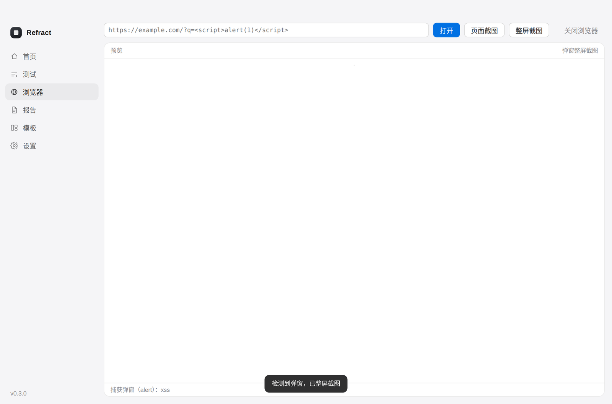
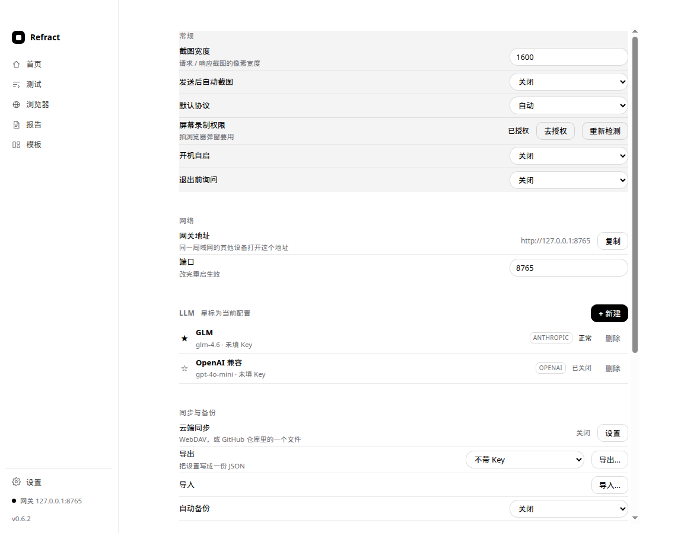
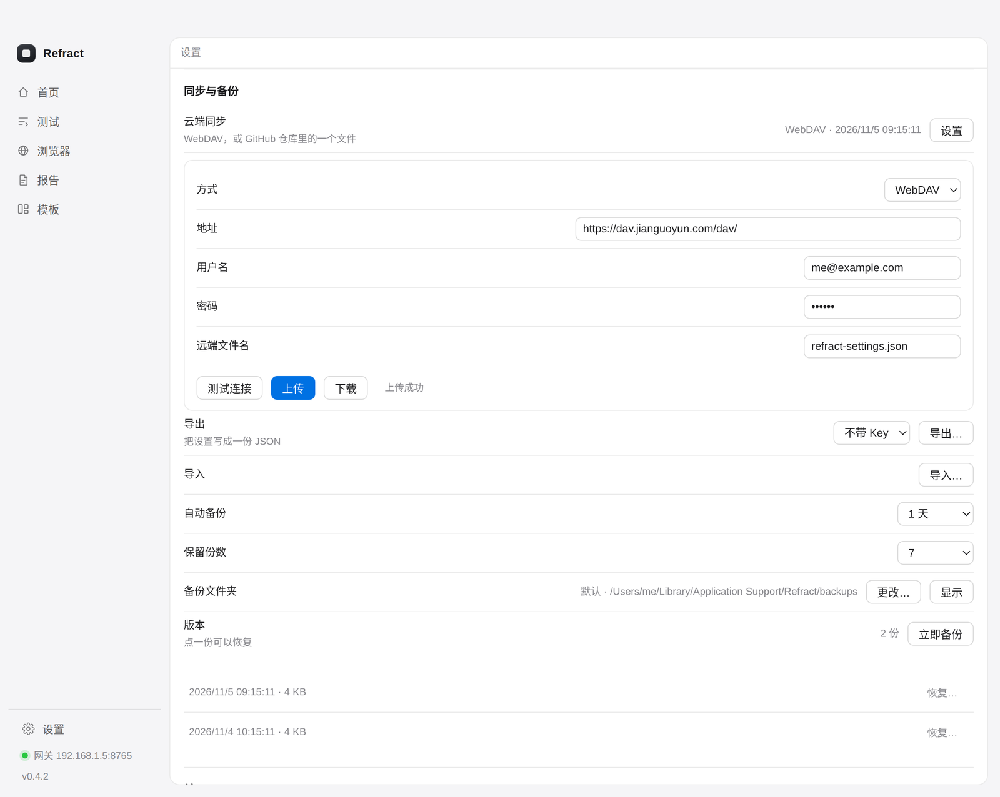
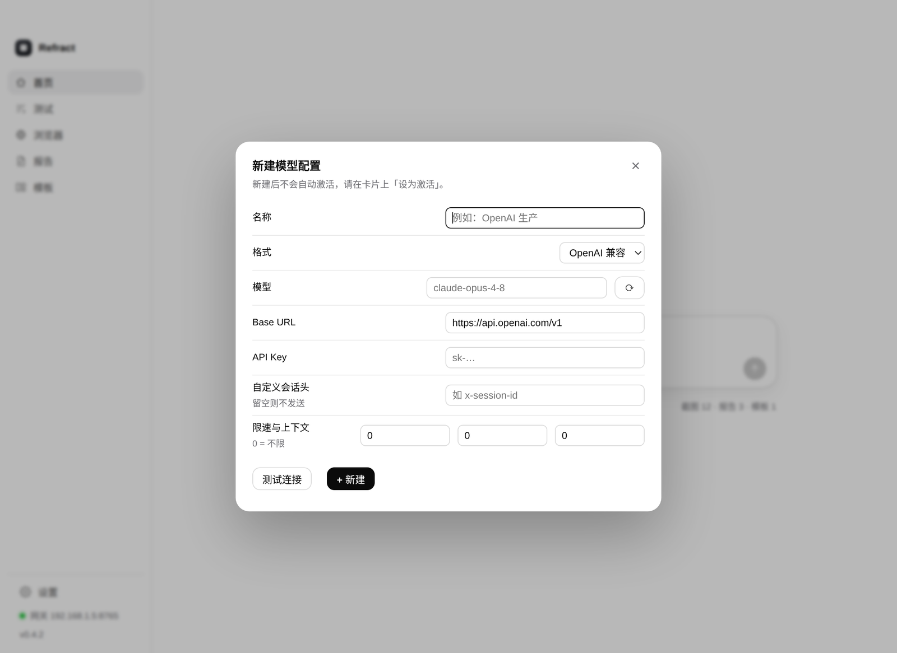

# Refract

漏洞测试与报告工作台。桌面客户端，把「发包 → 截图 → 写报告」串成一条线。

0.6.0：界面收成黑白窄栏；报告可导出 zip（`标题/report.md` 与 `images/01.png`）；Windows 提供 NSIS 安装包；macOS 屏幕录制按「检测 → 说明 → 系统设置 → 回到窗口自动补拍」走通。


## 功能

**首页**
- 打开是居中的输入框，发出第一条消息后平滑落到底部，消息从下面长出来
- 把请求文件拖进输入框（.txt / .http / .har），或者直接说「根据这个写一份报告」
- 输入框右下角是模型药丸，点开左边选模型、右边选供应商，底部「管理模型」直接跳设置

**测试**
- 直接粘贴原始 HTTP 请求，按字节发出，不经过任何中间层
- 支持 HTTP/2：自动协商，服务端不支持时静默回落到 1.1；也可以强制 1.1 或 2
- 响应按 Burp 的配色渲染：头名称藏青、Cookie 值暗红、JSON 键藏青、字符串绿、数字蓝
- 一键生成 PNG 截图，左右分栏、行号、换行与 Burp Repeater 一致
- 截图和请求全程留在本机


**浏览器**
- 内置浏览器控制（Chrome DevTools 协议），不用装插件
- 输入地址直接打开，可以执行 JS、抓页面截图
- 页面弹出 alert/confirm 时会自动整屏截图，XSS 弹窗能留下证据



**远程访问**
- 启动时在 8765 端口起一个本地服务，同一局域网的其他电脑用浏览器打开 `http://<你的IP>:8765` 就是同一个界面
- 侧栏底部一直显示这个地址，点一下复制
- 端口可在设置里改；改完重启生效

**设置**



- 侧栏底部固定「设置」，点开是上拉的菜单：常规 / 网络 / LLM / 备份 / 关于
- 常规、网络、关于都是行式开关，改完立刻生效
- 同步与备份：WebDAV 或 GitHub 仓库同步、导出 / 导入 JSON、
  自动备份（1 小时 / 6 小时 / 1 天 / 1 周）、保留份数、备份文件夹、按版本恢复

  

  同步上传的内容默认不含 API Key，也不含同步凭据本身

**报告**


- 四栏：模板、账号密码、漏洞详情、其他要求；账号密码会一并交给模型当测试上下文
- 调用你配置的大模型生成 Markdown 报告
- 后端内置写作约束：标题固定句式、不夸大、段落不超过三句、禁用「值得注意的是」「综上所述」这类腔调，保证每次输出风格一致
- 生成结果可编辑、可复制。保存时把截图放进 `images/` 并附在文末
- 导出写成 zip：`<标题>/report.md`，图片在 `<标题>/images/01.png`，正文用相对路径 `images/01.png`

**模板**
- 内置通用、补天、漏洞盒子、CNVD、教育行业五套
- 支持新建、修改、删除、恢复内置；模板里可用 `{{title}}` `{{url}}` 这类占位符

**模型**
- OpenAI 兼容与 Anthropic 兼容两种协议，可加多个服务，随时切换
- 模型配置以卡片呈现：星标激活、状态、模型、Key 尾号，点卡片进去加账号、勾选模型
- 右上角「+ 新建」弹出配置表单，可先测试连接再创建

  

- 代理：`http://`、`https://`、`socks5://`，可带账号密码；走代理时改成整段返回（不流式）
- 自定义会话头：填了名字后每个请求都带这个头，值是本进程固定的 session id（给做粘性路由/提示缓存的网关用）
- 每秒 / 每分钟限速：服务级排队，0 表示不限
- 上下文窗口（K）：超出就从最早的消息开始丢，系统提示保留
- 内置智谱 GLM 预设（Anthropic 协议，`glm-4.6`），填上自己的 API Key 就能用
- **仓库和安装包都不含任何 API Key**，谁用谁自己填，Key 只写在本机 `settings.json`
- 支持流式输出，可测试连接、拉取模型列表并直接选

**更新**
- 从 GitHub Releases 检查新版本，进度条下载，macOS 上自动挂载 dmg、替换 `/Applications` 里的旧版本并重启

## 开发

```bash
npm install
npm start        # 需要图形环境
npm test         # 无界面冒烟测试
```

## 打包

```bash
npm run dist:mac     # 需要 macOS，产出 dist/*.dmg
npm run dist:win     # 需要 Windows，产出 dist/Refract-<version>-win-x64.exe
npm run dist:linux   # 可选，产出 AppImage
```

推 `v*` 标签会触发 GitHub Actions：macOS 打出 arm64 与 x64 两个 dmg，Windows 打出 NSIS 安装包，一起附到同一个 Release。

## 数据位置

| 内容 | 路径 |
| --- | --- |
| 设置、模板 | macOS `~/Library/Application Support/Refract/`，Windows `%APPDATA%\Refract\` |
| 截图 | 同上 `shots/` |
| 报告 | `~/Documents/Refract/<时间>-<标题>/` |

API Key 只写在本机 settings.json，不会上传。

## 已知限制

- 安装包未做 Apple 签名与公证。首次打开如果被拦，右键 → 打开，或在「系统设置 → 隐私与安全性」里放行。
- Windows 安装包未签名。SmartScreen 可能提示「Windows 已保护你的电脑」。点「更多信息」，再点「仍要运行」。
- 自动更新依赖 Release 里的 dmg 或 exe 资产名。
- macOS 整屏截图需要屏幕录制权限。授权后如果画面仍是全黑，退出 Refract 再打开。
