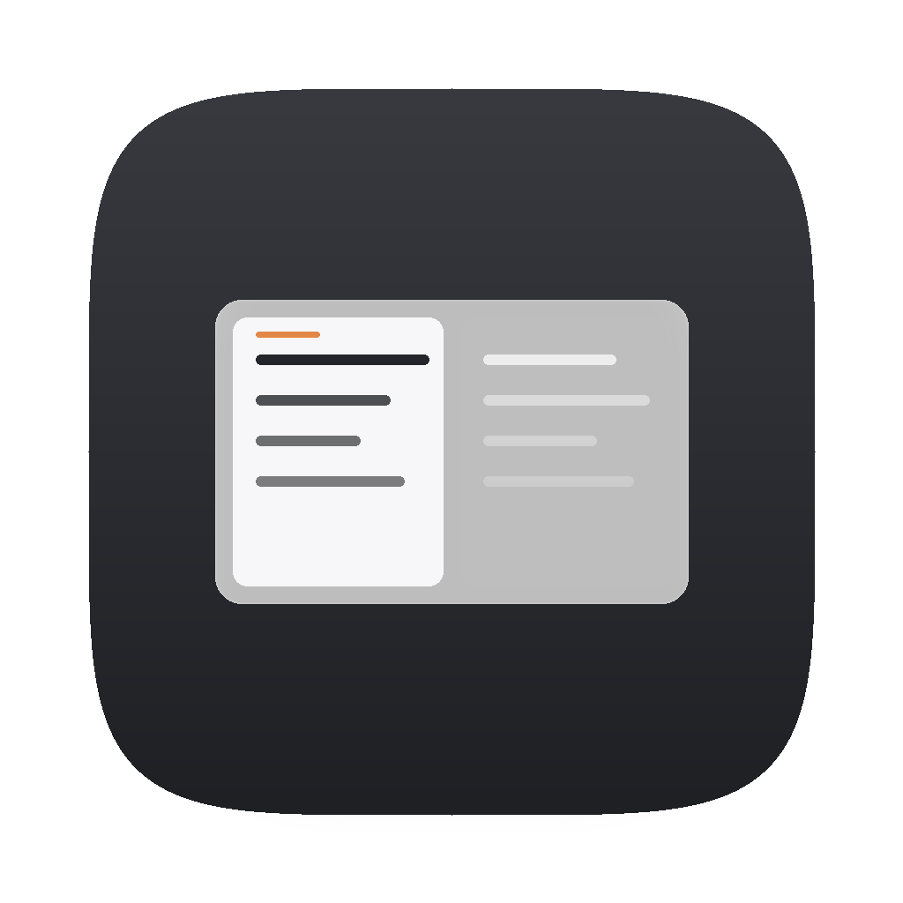
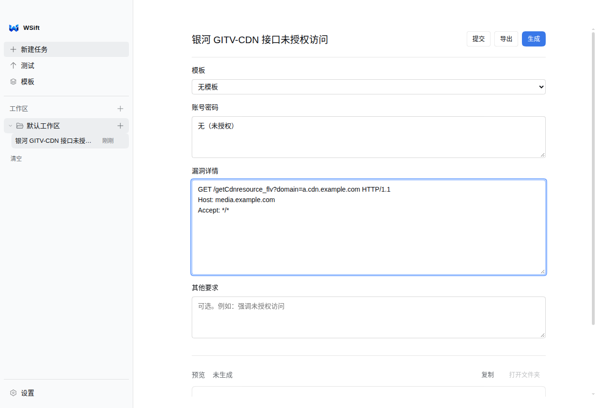
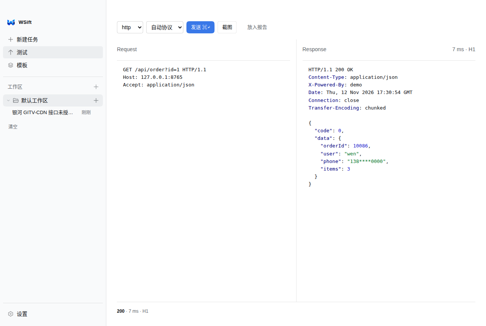
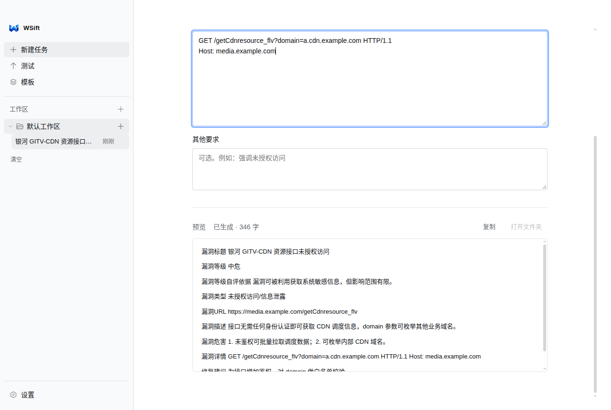
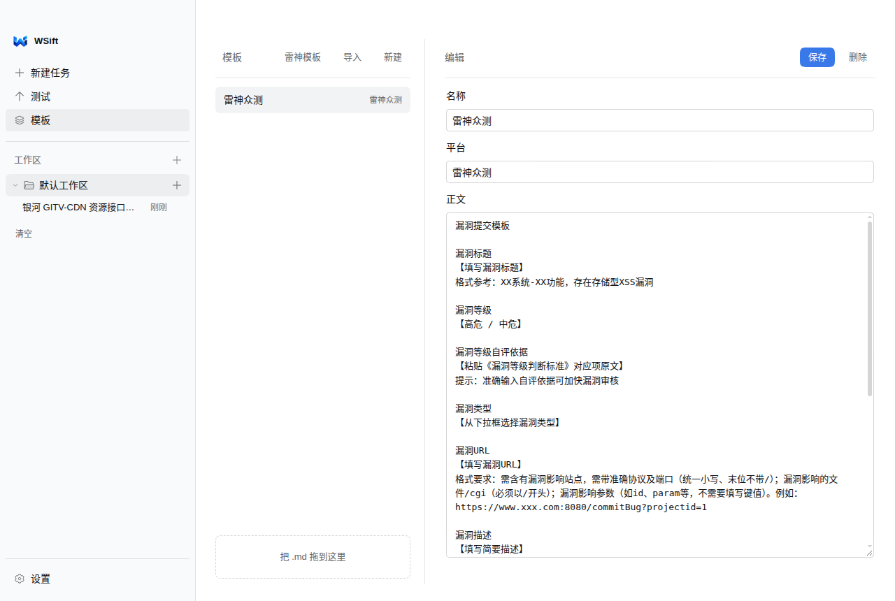
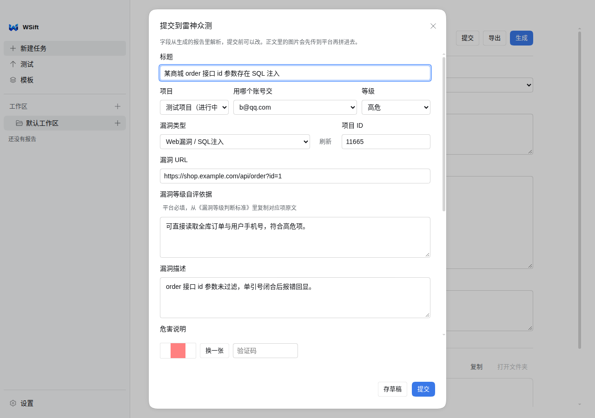
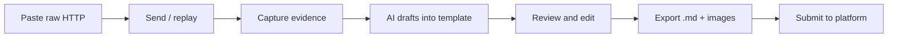

<div align="center">



# WSift

**Find. Verify. Preserve.**

A Local-First Web Security Testing Workspace

[](https://github.com/VVen1F/WSift/releases/latest)
[](LICENSE)
[](#install)

[English](README.md) · [简体中文](README.zh-CN.md)

</div>

WSift is a desktop workbench for the part of security testing that happens *around* the findings: replaying a request, proving it worked, keeping the evidence, and turning it into a report that a program will accept.

It is deliberately not a scanner and not a Burp Suite replacement. You point it at the request you already have; it helps you verify, capture and deliver.



## Why WSift

| The friction | What WSift does |
|---|---|
| The request, the screenshot and the report live in three different places | One task holds the raw HTTP, the evidence screenshots and the report draft |
| Proving a finding means hand-cropping Burp screenshots | Replay the packet and get a Repeater-style PNG with request, response, status and latency |
| Every program wants its own report format | Report templates (bundled, or any `.md` you import) drive the AI draft |
| Writing the same sections again for every finding | Structured fields are parsed out of the draft, editable before export |
| "AI wrote a vulnerability that does not exist" | The model sees your real request/response and screenshots; every field stays editable |
| Submitting means retyping everything into the platform | 雷神众测 delivery: pick project → pick a participating account → captcha → submit or save a draft |

## Features

### Raw HTTP workbench

Send the request exactly as typed — no repackaging, no middleware. HTTP/1.1 and HTTP/2 with silent fallback, raw socket I/O, proxy support, and Burp-style colouring for headers, cookies, JSON keys, strings and numbers.



### Evidence-grade screenshots

One click turns the current exchange into a Repeater-style PNG: split panes, line numbers, status line and latency. Rendered at 2× for Retina, width configurable, height follows the content (up to 2500 px, 5000 px for long bodies). Screenshots stay on disk, in your own folder.

### AI-assisted reports

Bring any OpenAI-compatible provider or Anthropic. The model writes into *your* template, using the packet and screenshots you supplied; a multimodal pass can read captchas or popup screenshots. The result is plain Markdown — you review it, edit it, then export.



- Export writes `report.md` plus `images/` and a zip to `~/Desktop/WSift`
- Evidence images are placed under the packet they belong to, not piled at the end
- Field parsing (`漏洞等级`, `自评依据`, `漏洞类型`, …) feeds the submission form directly

### Templates

Bundled presets (including 雷神众测), or drop in any `.md` report template. Templates are plain text — version them, share them, diff them.



### Platform delivery (雷神众测)

- Multiple accounts, each with its own captcha + mailbox login
- Projects are read from the platform per account; only projects you actually joined are listed
- Grades are read per project, not hard-coded
- Drafts, captcha solving (manual or optional `ddddocr`), and image upload with size checks



### Local-first data

Everything lives in the Electron `userData` directory: settings, tasks, reports, screenshots. JSON export/import, scheduled backups with retention, and optional WebDAV or GitHub-repo sync. Sync and backup redact provider keys and platform tokens by default.

### Workspaces, archive and remote access

Tasks are grouped into workspaces; finished ones go to an archive you can restore from. An optional LAN web server (`:8765`) serves the same UI to another machine on your network — off unless you turn it on.

## Workflow



## Architecture

WSift is an Electron app with **no runtime dependencies** — the main process uses only Node's standard library.

```
electron/
  main.js       window, IPC, permissions, orchestration
  http.js       raw HTTP/1.1 client (socket, TLS, proxy)
  http2.js      HTTP/2 with transparent fallback to 1.1
  shot.js       Repeater-style PNG rendering (offscreen)
  report.js     prompt assembly, template fill, bundle/export
  llm.js        OpenAI-compatible + Anthropic clients, vision, streaming
  templates.js  template storage and presets
  leishen.js    雷神众测 API: login, projects, grades, upload, submit
  store.js      settings persistence (atomic write)
  backup.js     redacted backups, import/export
  sync.js       WebDAV / GitHub sync
  remote.js     LAN web server
  updater.js    GitHub Releases auto-update
renderer/
  index.html    single-page UI (no framework)
  app.js        UI state and bindings
  style.css     DSH-derived design tokens
  icons.js      icon set (from DeepSeek Harness, MIT)
```

- **Main process** owns network, files, screenshots and credentials.
- **Renderer** is a classic script with a small `window.api` bridge; no bundler, no node integration.
- **Data** is plain JSON + PNG files; nothing is uploaded unless you configure sync or submit.
- **Secrets** (API keys, platform tokens, mailbox passwords) stay on disk in the userData directory and are redacted from backups.

## Install

Download from [Releases](https://github.com/VVen1F/WSift/releases/latest):

| Platform | File |
|---|---|
| macOS (Apple Silicon) | `WSift-<version>-arm64.dmg` |
| macOS (Intel) | `WSift-<version>-x64.dmg` |
| Windows x64 | `WSift-<version>-x64.exe` |
| Linux x86_64 | `WSift-<version>-x86_64.AppImage` |

> Builds are **unsigned**. On macOS, right-click → Open, or run `xattr -dr com.apple.quarantine /Applications/WSift.app`. On Linux: `chmod +x WSift-*.AppImage`.

### From source

```bash
git clone https://github.com/VVen1F/WSift.git
cd WSift
npm install
npm start          # or: npm run dev
```

```bash
npm test           # unit tests (182 assertions, no network)
npm run test:e2e   # end-to-end against a local mock platform
npm run dist:mac   # or dist:win / dist:linux
```

Requires Node.js 22+ and Electron 45 (installed by `npm install`).

## Configuration

All settings live in **Settings** (bottom of the sidebar):

- **LLM providers** — base URL, model, API key, proxy; OpenAI-compatible or Anthropic; several providers can coexist.
- **Network** — default protocol (auto / HTTP/1.1 / HTTP/2), proxy, LAN gateway port.
- **Screenshots** — pixel width and output directory.
- **Accounts** — platform accounts for delivery; credentials stay local.
- **Backup & sync** — interval, retention, folder, WebDAV or GitHub repo, JSON export/import.

> **Credentials:** API keys, platform tokens, mailbox passwords and cookies are sensitive. They are stored unencrypted in the app's data directory, excluded from sync payloads by default, and redacted in backups — but anyone with access to your machine can read them. Treat the data directory like a credential store.

## Roadmap

**Done**
- Raw HTTP/1.1 + HTTP/2 workbench with proxy
- Repeater-style evidence screenshots (2×, auto-height)
- AI report drafting with templates, field parsing, Markdown/ZIP export
- 雷神众测 multi-account delivery with project-scoped grades and drafts
- Local-first storage, backups, WebDAV/GitHub sync, LAN remote UI
- macOS / Windows / Linux builds and auto-update

**In progress**
- Code signing and notarization for macOS and Windows
- More SRC platform adapters (account model is already platform-aware)

**Planned**
- Import/annotate existing evidence (HAR) without re-sending
- Shared workspaces for small teams
- Configurable evidence themes beyond Repeater style

## Contributing

Issues and pull requests are welcome.

1. Fork and clone the repo, then `npm install`
2. Keep the change focused; the main process must stay dependency-free
3. Run `npm test` before pushing; UI changes should be checked against the design rules in [`docs/design`](docs/design)
4. Open a PR with what changed and how you verified it (screenshots for UI changes)

There is no `CONTRIBUTING.md` yet — the four steps above are the whole process. Release notes live in [CHANGELOG.md](CHANGELOG.md).

## License

MIT — see [LICENSE](LICENSE). Copyright (c) 2026 WenYifan.

Icon and in-app mark are the WSift brand assets; the icon set in the UI is from [DeepSeek Harness](https://github.com/deepseek-ai/deepseek-harness) (MIT).

<div align="center">

**WSift** · Find. Verify. Preserve.

[Repository](https://github.com/VVen1F/WSift) · [Releases](https://github.com/VVen1F/WSift/releases/latest) · [Design notes](docs/design)

</div>
