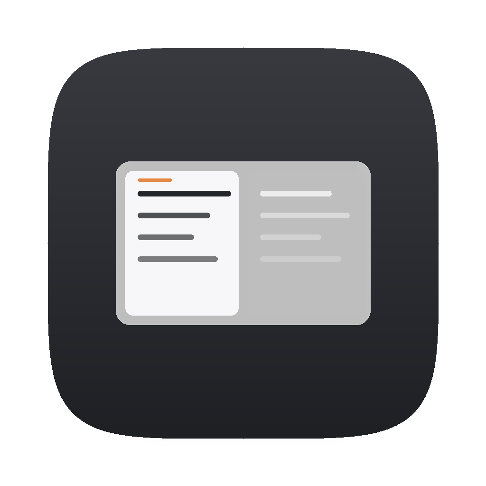
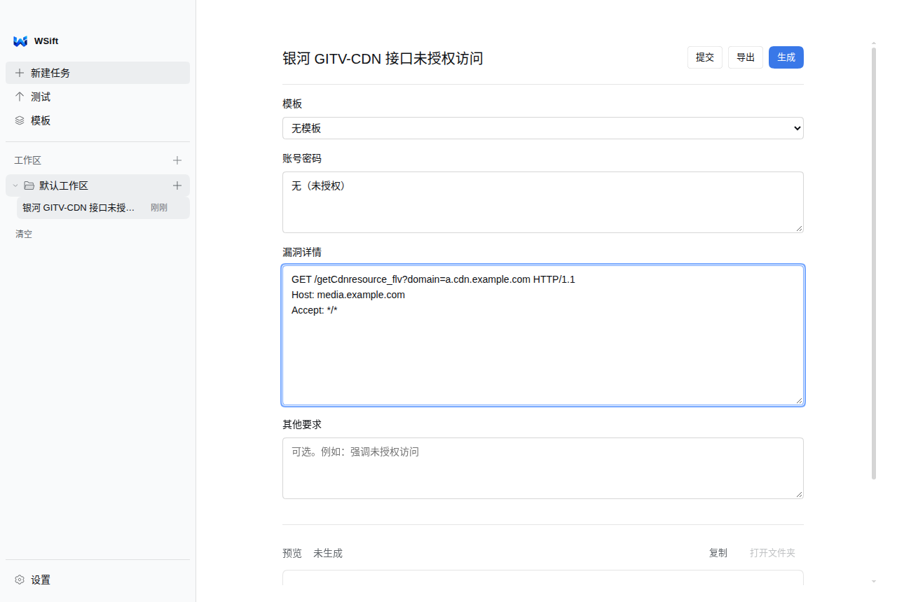
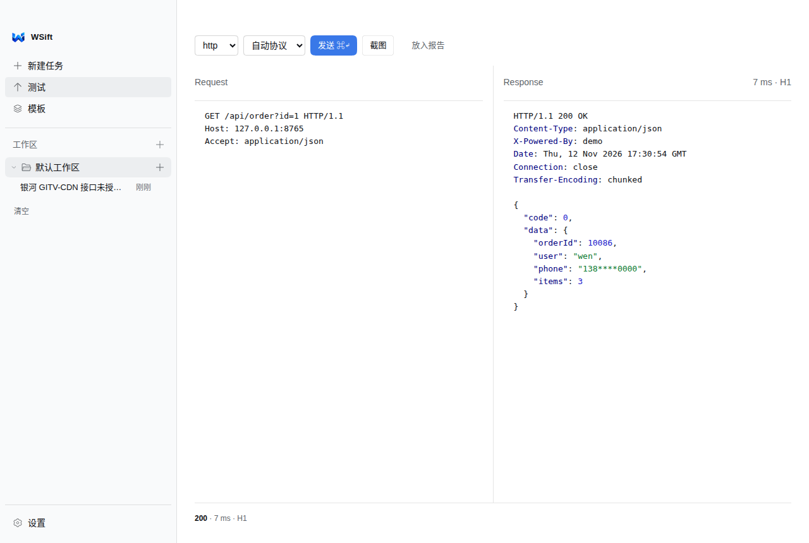
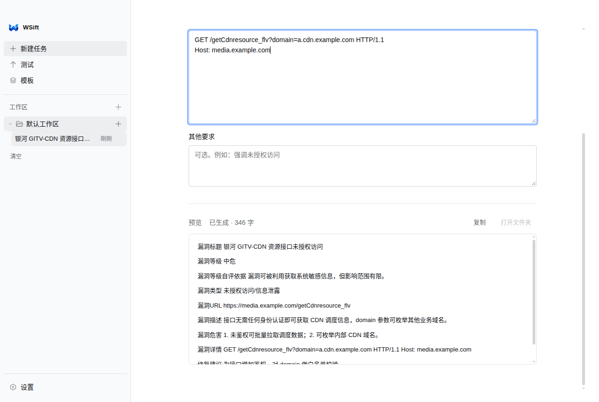
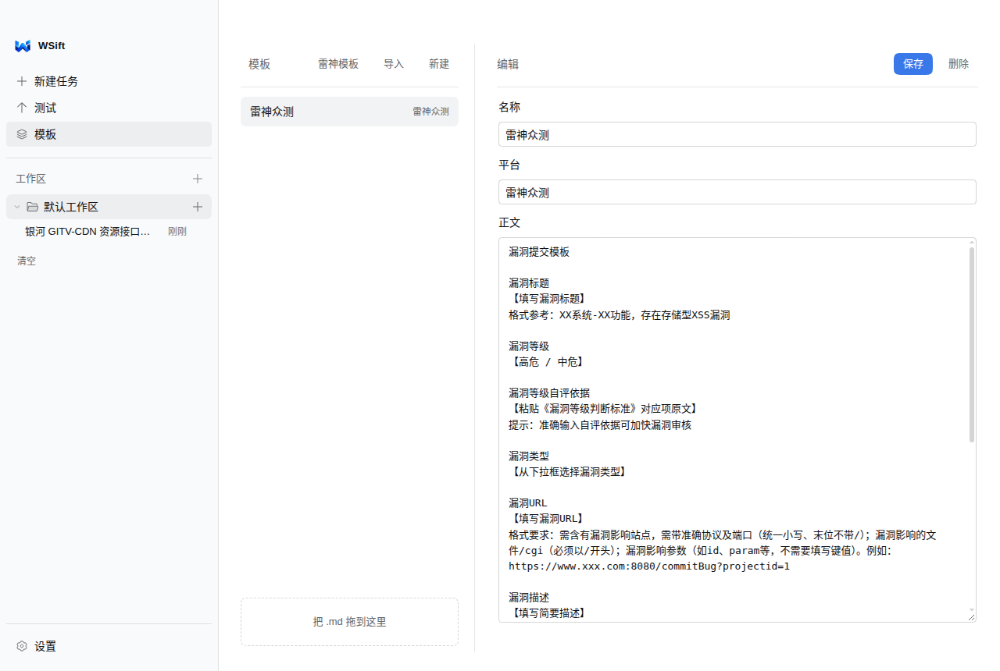
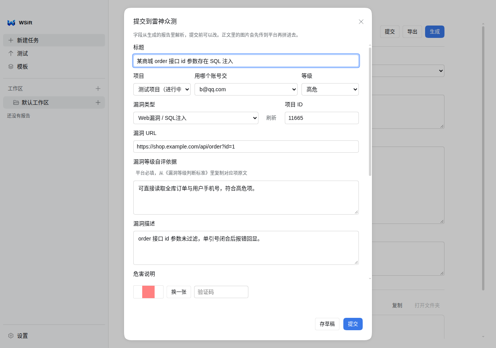
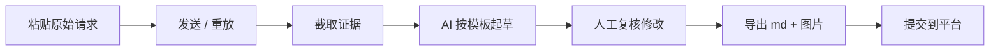

<div align="center">



# WSift

**Find. Verify. Preserve.**

本地优先的 Web 安全测试工作台

[](https://github.com/VVen1F/WSift/releases/latest)
[](LICENSE)
[](#安装)

[English](README.md) · [简体中文](README.zh-CN.md)

</div>

WSift 是一个桌面工作台，专门处理安全测试里「发现之后」的那一段：把请求重放一遍、证明漏洞真的存在、把证据留下来，最后变成平台愿意收的报告。

它不是扫描器，也不是 Burp Suite 的替代品。你带着已经抓到的请求进来，它负责验证、取证和交付。



## 为什么需要 WSift

| 实际遇到的麻烦 | WSift 的做法 |
|---|---|
| 请求、截图、报告分散在三个地方 | 一条任务同时装着原始请求、证据截图和报告草稿 |
| 证明漏洞要手动截 Burp，还要裁剪 | 重放数据包，直接出一张 Repeater 风格 PNG（请求、响应、状态、耗时） |
| 每个项目都有自己的一套报告格式 | 报告模板驱动 AI 生成（内置模板，也可以导入任意 `.md`） |
| 每条漏洞都要重写同样的章节 | 从草稿里解析成结构化字段，导出前可改 |
| 担心「AI 编了一个不存在的漏洞」 | 模型看到的是你的真实请求/响应和截图，所有字段都能改 |
| 提交时要把信息重新敲进平台 | 雷神众测投稿：选项目 → 选参与账号 → 验证码 → 提交/存草稿 |

## 功能

### 原始 HTTP 工作台

请求按你写的字节原样发出，不重新封装。支持 HTTP/1.1 与 HTTP/2（自动协商、静默回落）、原始 socket、代理，响应按 Burp 的配色渲染：头字段、Cookie、JSON 键、字符串、数字各有颜色。



### 证据级截图

一键把当前请求/响应渲染成 Repeater 风格 PNG：左右分栏、行号、状态行和耗时。2× 渲染（Retina 清晰），宽度可配，高度随内容增长（最多 2500px，长正文 5000px）。截图落在你自己的目录里。

### AI 辅助写报告

接任意 OpenAI 兼容服务或 Anthropic。模型按**你的模板**写，材料是你给的请求和截图；多模态还能读验证码、弹窗截图。产出就是 Markdown，你审、你改，然后导出。



- 导出把 `report.md`、`images/` 和 zip 写到 `~/Desktop/WSift`
- 证据图贴在对应数据包下面，不会全堆在文末
- 解析出「漏洞等级 / 自评依据 / 漏洞类型」等字段，直接填进投稿表单

### 模板

内置模板（含雷神众测），也可以拖入任意 `.md`。模板就是纯文本：能版本化、能分享、能 diff。



### 平台投稿（雷神众测）

- 多账号，各自走图形码 + 邮箱验证码登录
- 项目按账号从平台实时拉取，只列真正报名的项目
- 等级按项目读取，不是写死的四档
- 支持存草稿、验证码（手动或可选 `ddddocr`）、图片上传与大小校验



### 本地优先的数据

设置、任务、报告、截图全部在 Electron 的 `userData` 目录里。支持 JSON 导出/导入、定时备份与保留份数，以及可选的 WebDAV / GitHub 仓库同步。同步和备份默认会抹掉模型 Key 与平台 token。

### 工作区、归档与远程访问

任务按工作区分组，做完的进归档、随时恢复。可选的局域网 Web 服务（`:8765`）让同一网络下的另一台机器打开同一个界面——默认关闭，需要时再开。

## 工作流程



## 技术架构

Electron 应用，**无运行时依赖**——主进程只用 Node 标准库。

```
electron/
  main.js       窗口、IPC、权限、流程编排
  http.js       原始 HTTP/1.1 客户端（socket / TLS / 代理）
  http2.js      HTTP/2，失败时透明回落到 1.1
  shot.js       Repeater 风格 PNG 渲染（离屏）
  report.js     提示词组装、模板填充、打包导出
  llm.js        OpenAI 兼容 + Anthropic 客户端、视觉、流式
  templates.js  模板存储与内置预设
  leishen.js    雷神众测 API：登录、项目、等级、上传、提交
  store.js      设置持久化（原子写）
  backup.js     脱敏备份、导入导出
  sync.js       WebDAV / GitHub 同步
  remote.js     局域网 Web 服务
  updater.js    GitHub Releases 自动更新
renderer/
  index.html    单页界面（无框架）
  app.js        界面状态与事件绑定
  style.css     基于 DSH 的设计 token
  icons.js      图标集（来自 DeepSeek Harness，MIT）
```

- **主进程**负责网络、文件、截图和凭据。
- **渲染进程**是普通脚本 + 一个很小的 `window.api` 桥，没有打包器，也没有 node 集成。
- **数据**就是 JSON + PNG；不配置同步或投稿的话，什么都不会上传。
- **敏感信息**（API Key、平台 token、邮箱密码）留在 userData 目录，备份时脱敏。

## 安装

从 [Releases](https://github.com/VVen1F/WSift/releases/latest) 下载：

| 平台 | 文件 |
|---|---|
| macOS（Apple Silicon） | `WSift-<version>-arm64.dmg` |
| macOS（Intel） | `WSift-<version>-x64.dmg` |
| Windows x64 | `WSift-<version>-x64.exe` |
| Linux x86_64 | `WSift-<version>-x86_64.AppImage` |

> 安装包**未签名**。macOS 上右键 → 打开，或执行 `xattr -dr com.apple.quarantine /Applications/WSift.app`；Linux 上先 `chmod +x WSift-*.AppImage`。

### 从源码运行

```bash
git clone https://github.com/VVen1F/WSift.git
cd WSift
npm install
npm start          # 或 npm run dev
```

```bash
npm test           # 单元测试（182 项，不联网）
npm run test:e2e   # 本地假平台上的端到端测试
npm run dist:mac   # 或 dist:win / dist:linux
```

需要 Node.js 22+，Electron 45 由 `npm install` 安装。

## 配置

所有配置都在侧栏底部的**设置**里：

- **模型**：Base URL、模型名、API Key、代理；OpenAI 兼容或 Anthropic，可以并存多个
- **网络**：默认协议（自动 / HTTP/1.1 / HTTP/2）、代理、局域网端口
- **截图**：像素宽度、输出目录
- **账号**：投稿用的平台账号，凭据只存本地
- **备份与同步**：间隔、保留份数、目录、WebDAV 或 GitHub 仓库、JSON 导入导出

> **凭据安全**：API Key、平台 token、邮箱密码、Cookie 都属于敏感信息。它们以明文存在应用数据目录里，默认不进同步、备份时会脱敏——但能读到你磁盘的人就能读到它们。请把这个目录当成密码仓库对待。

## 路线图

**已完成**
- 原始 HTTP/1.1 + HTTP/2 工作台与代理
- Repeater 风格证据截图（2×、自动加高）
- AI 报告（模板驱动、字段解析、Markdown/ZIP 导出）
- 雷神众测多账号投稿（项目内等级、草稿）
- 本地优先存储、备份、WebDAV/GitHub 同步、局域网远程界面
- macOS / Windows / Linux 构建与自动更新

**进行中**
- macOS 与 Windows 的签名 / 公证
- 更多 SRC 平台适配（账号模型已经是按平台分的）

**计划中**
- 导入已有证据（HAR）并标注，不重复发包
- 面向小团队的共享工作区
- Repeater 之外可配置的证据样式

## 参与贡献

欢迎 Issue 和 PR。

1. Fork 并 clone，然后 `npm install`
2. 改动尽量聚焦；主进程必须保持零运行时依赖
3. 提交前跑 `npm test`；界面改动对照 [`docs/design`](docs/design) 里的规则自查
4. 发 PR 时说明改了什么、怎么验证的（界面改动请附截图）

目前还没有 `CONTRIBUTING.md`，上面四步就是全部流程。

## 许可证

MIT，见 [LICENSE](LICENSE)。Copyright (c) 2026 WenYifan。

应用图标与内部标识是 WSift 的品牌资源；界面图标来自 [DeepSeek Harness](https://github.com/deepseek-ai/deepseek-harness)（MIT）。

版本改动见 [CHANGELOG.md](CHANGELOG.md)。

<div align="center">

**WSift** · Find. Verify. Preserve.

[仓库](https://github.com/VVen1F/WSift) · [版本发布](https://github.com/VVen1F/WSift/releases/latest) · [设计说明](docs/design)

</div>
